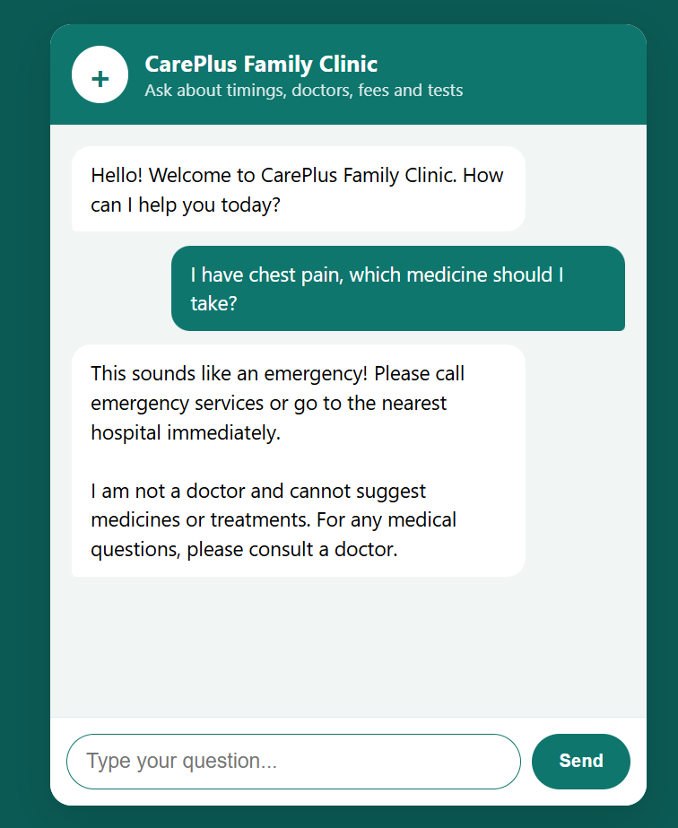
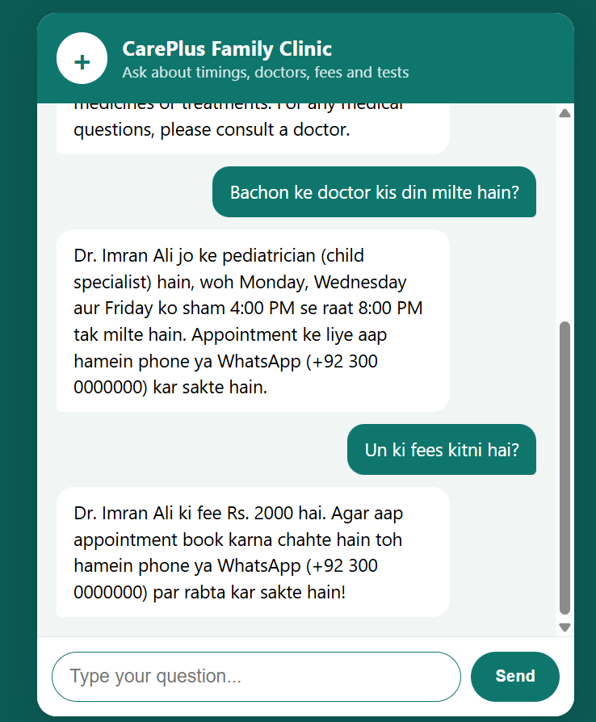
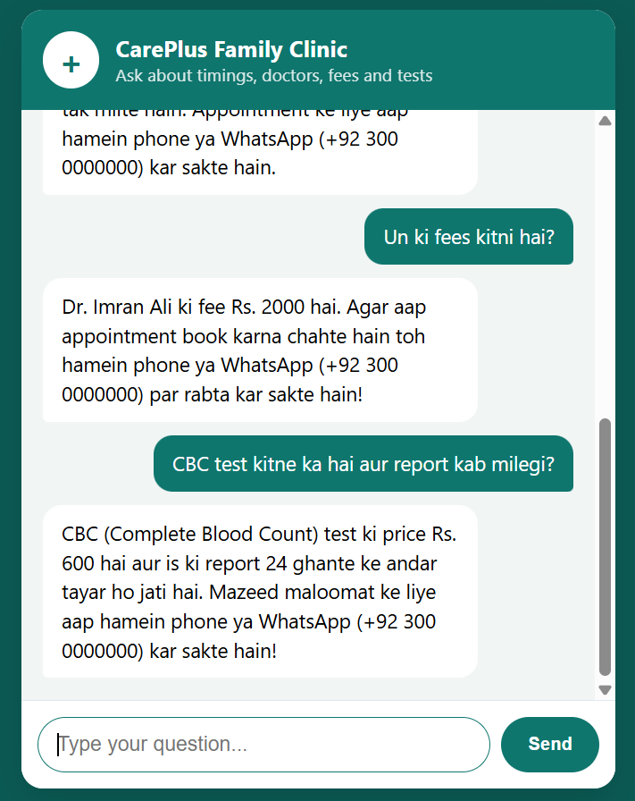

# AI Business Chatbot (Clinic Demo)

An AI chatbot for small businesses (clinics, schools, shops). It answers customer questions about timings, doctors, fees and appointments using only the business's own data, in **English, Roman Urdu or Urdu**.

## Screenshots

<p align="center">
  
  
  
</p>

## Features

- Answers only from `data/clinic.json`, so it never invents prices or timings
- Replies in the visitor's language (English, Roman Urdu, Urdu)
- Remembers recent messages for follow-up questions
- Safety rules: no medical advice, emergency guidance, refuses unrelated questions
- Auto retry and fallback model when the Gemini API is busy
- API key stays on the server

**Stack:** HTML, CSS, JavaScript, Node.js, Express, Gemini API

## Getting Started

```bash
git clone https://github.com/YOUR_USERNAME/business-chatbot.git
cd business-chatbot
npm install
```

Create a `.env` file (get a free key from [Google AI Studio](https://aistudio.google.com)):

```
GEMINI_API_KEY=your_key_here
GEMINI_MODEL=gemini-3.5-flash-lite
GEMINI_FALLBACK_MODEL=gemini-3.8-flash
```

Only `GEMINI_API_KEY` is required. Then run:

```bash
npm start
```

Open [http://localhost:3000](http://localhost:3000).

## Use It for Another Business

1. Copy `data/clinic.json` to a new file, e.g. `data/school.json`
2. Replace its content with the new business's details
3. Set `BUSINESS_DATA=school.json` in `.env` and restart

## Note

Demo with sample data; the phone number and address are placeholders. The bot gives general business information only, not medical advice.

**Author:** Alamdar.